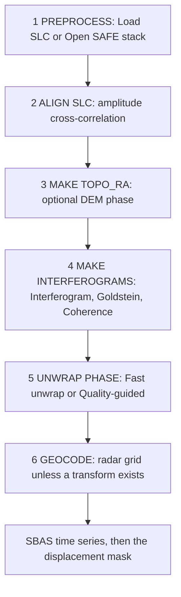

# Pipeline

The seven buttons in the window call the same functions as
`ai-insar check` and `ai-insar run`. Stages live in
`ai_insar.pipeline.engine`. Each stage clears the products of the stages
that depend on it, so an older velocity cannot linger after you re-filter.

LOS displacement is positive toward the radar. Subsidence is negative
velocity and positive unwrapped interferogram phase. See the README for the
phase equation. The code constants are `C_BAND_WAVELENGTH_M` and
`phase_from_los` / `los_from_phase` in `ai_insar.conventions`.

## GMTSAR flowchart

The Pipeline menu and the numbered buttons follow the public GMTSAR pair
order (David Sandwell and others, UCSD; GPL-3.0). GMTSAR source is not in
this repository. Each box is MIT code in this project. The same diagram is
in the [README](../README.md#gmtsar-stage-order). Help → GMTSAR flowchart
shows the list without the drawing.



| GMTSAR stage | AI Insar control | What the code does |
| --- | --- | --- |
| PREPROCESS | Button 1, File → Load SLC stack, Open SAFE stack | Read a `complex64` cube. A SAFE manifest can show an orbit number. The crop is not resampled with that orbit. |
| ALIGN SLC | Pipeline → ALIGN SLC | One constant shift per date from amplitude cross-correlation, applied with an FFT phase ramp (`pipeline/align.py`). |
| MAKE TOPO_RA | Pipeline → MAKE TOPO_RA | `phase = -4π/λ · B_perp / (R sin θ) · height` when a DEM `.npy` and a non-zero perpendicular baseline are set (`pipeline/topo.py`). Otherwise the interferogram is unchanged. |
| MAKE INTERFEROGRAMS | Buttons 2–4, or Pipeline → MAKE INTERFEROGRAMS | `later * conj(earlier)`, Goldstein, SLC-pair coherence. |
| UNWRAP PHASE | Button 5 | Fast unwrap by default. Quality-guided remains a separate menu. A border plane is removed. |
| GEOCODE | Pipeline → GEOCODE | No radar-to-map transform is stored. Products and map export stay on the radar grid. |
| SBAS | Button 6, then button 7 | Time series after the pairs, then the displacement mask. |

**Run all stages**, `ai-insar check`, and `ai-insar run` do not call ALIGN SLC,
MAKE TOPO_RA, or GEOCODE. They process the stack that is already loaded.

## Stage by stage

### 1. Generate / load sample SLC

The button calls `generate_demo_stack()`, which is
`generate_subsidence_stack()` with its defaults:

| Parameter | Default |
| --- | --- |
| dates | 8, every 36 days, starting 2020-01-08 |
| size | 72 × 72 |
| wavelength | Sentinel-1 C-band, 5.405 GHz (`299792458 / 5.405e9` m ≈ 0.055466 m) |
| bowl | Gaussian, σ = 11 px, centred on the array |
| model peak | `rate_m_yr = 0.22`, stored as LOS velocity **−0.22 m/yr** times the Gaussian |
| temporal coherence | 0.9 shared speckle; the rest is independent each date |
| per-date plane | normal piston and tilts, standard deviation 0.35 rad |
| seed | 7 |

The continuous peak is exactly −0.22 m/yr only at the Gaussian centre, which
falls between pixels. The strongest pixel is slightly weaker. `ai-insar check`
reports a 3×3 mean around that pixel, so its “truth” line is not exactly
−0.2200.

File → Load SLC stack reads a `complex64` cube instead. That path has no
truth arrays. `check` is only defined for the synthetic bowl.

### 2. Interferogram

`date_pairs(n_dates, max_date_span)` keeps every pair `(earlier, later)` with
`1 <= later - earlier <= max_date_span`. The default span is 3. Eight dates
therefore make 18 pairs (7 + 6 + 5), with temporal baselines of 36, 72, and
108 days on the demo.

`form_interferograms` computes:

```text
ifg = slc[later] * conj(slc[earlier])
```

The product is a chunked NumPy multiply (`np.multiply` into a `complex64`
buffer). Pairs are grouped so the indexed date cubes stay near 32 MiB.
When Numba is installed (`pip install "ai-insar[fast]"`), that product is
a compiled parallel loop. It is the stage result when `insardev` is not
used. A reversed index raises `ValueError`. The result is `complex64`,
shape `(n_pairs, height, width)`.

`pip install "ai-insar[insardev]"` (Python 3.12+) installs upstream
`insardev`. Stage 2 then calls `Stack.pairs(...).interferogram()` first,
with the later date as the reference. A returned complex cube is kept
even when the values differ from the NumPy/Numba product. The in-tree
product runs when the package is missing, the call fails, or
`AI_INSAR_BACKEND=numpy`. The log line names the backend (`NumPy`,
`Numba`, or `InSARdev`). Accepting the extra means accepting
InSARdev-SAL-1.0, including a subscription for funded academic use. The
repository owner has personally accepted that license for this academic
extra. See [install.md](install.md) and [NOTICE](../NOTICE).

File → Open SAFE stack… is another way to fill the SLC cube: many SAFE
zips, one crop, time-sorted. Stage 2 then runs on that cube. The crop is
not a coregistration. See [data-format.md](data-format.md#safe-stack).

### 3. Goldstein filter

The **Goldstein** menu is this stage. **Run Goldstein** uses the current
alpha. **Light (α = 0.3)**, **Default (α = 0.5)**, and **Strong (α = 0.8)**
set alpha and run the stage. The window stays at the Settings value
(default 32). Pipeline → Goldstein filter is the same call.

`goldstein_filter` overlap-adds a batched FFT of complex patches. With α = 0
the windows reconstruct the input (tested). The default is α = 0.5, window
32, overlap 0.5. Each patch spectrum is multiplied by `|FFT| ** alpha`
after an optional smooth of `|FFT|` (`spectrum_smooth`, default 3). The
batched transform follows InSARdev `goldstein_numpy` (Alexey Pechnikov),
ported in-tree with the owner's permission. It does not import `insardev`.
`AI_INSAR_FILTER=torch` uses PyTorch for that FFT when Torch is installed;
the default is SciPy. Numba (`pip install "ai-insar[fast]"`) speeds the
overlap-add. Images smaller than 8 pixels, or a requested window below 8,
are returned unchanged. The engine logs the count of 2π residues on the
wrapped filtered phase.

Unwrapping uses this phase. Coherence does not.

### 4. Coherence

The **Coherence** menu is this stage. **Run coherence** uses the current
window. **3×3 window**, **5×5 window** (the default), and **7×7 window**
set the boxcar and run the stage.

For each pair, a boxcar estimates

```text
gamma = |mean(late * conj(early))| / sqrt(mean(|early|^2) * mean(|late|^2))
```

from the SLC dates, clipped to [0, 1]. Mean coherence across pairs is kept
for the mask. Re-running coherence clears unwrap, the time series, and the mask.
The estimate does not read the Goldstein output.

### 5. Unwrap

The **Fast unwrap** menu is the default for **Run all stages**, `ai-insar
check`, and `ai-insar run`. It smooths the complex interferogram with a
Gaussian and then calls `numpy.unwrap` along range and azimuth, starting
from the middle of the image. That is the separable unwrap reimplemented
from the MIT example in InSARdev/edu `NISAR/nisar_numpy.py`. It is aimed at
smooth fields and is the performance path on CPU.

The **Quality-guided** menu is still available. Reliability is coherence
divided by one plus a local phase second-difference. Pixels below
`unwrap_min_coherence` (default 0.2) are barriers. Integration starts at the
highest reliability pixel and adds the wrapped neighbour difference
(`atan2(sin Δ, cos Δ)`). Numba runs that walk when it is installed
(`pip install "ai-insar[fast]"`); otherwise it is a Python heap. Set
`PipelineConfig.unwrap_method` to `quality` to use it from code.

`remove_ramp` then fits a plane on a border frame (default 4 px, weights at
least 0.3) and subtracts it, so the stable frame is the phase reference. A
centred bowl is weak on that frame. Pixels that were never unwrapped stay
NaN.

### 6. Time series

**Run all stages** and `ai-insar check` use SBAS. The menu bar has one menu
per method, and the stage-6 combo lists the same names in the same order as
`TIMESERIES_METHODS`: SBAS, Stacking, NSBAS, PS linear, Phase linking,
Seasonal. **Run** in a menu selects that method and writes `los_m` and
`velocity_m_yr`. Negative velocity is motion away from the radar.

| Menu | Code | What the arrays are |
| --- | --- | --- |
| SBAS | `invert_sbas` | Displacement at each date from the unwrapped pairs, then a linear slope. |
| Stacking | `stack_interferograms` | Weighted mean of each pair's LOS rate. The series is that rate times time. |
| NSBAS | `invert_nsbas` | The SBAS system plus one phase-rate unknown. Default constraint weight 0.25. No seasonal term. |
| PS linear | `persistent_scatterer_velocity` | Stacking velocity kept where amplitude dispersion ≤ 0.4 or mean coherence ≥ 0.5. Other pixels are NaN. |
| Phase linking | `sequential_phase_link` | EMI eigenvector (`numpy.linalg.eigh`) of the coherence matrix, then unwrapped pairs restore steps larger than π. |
| Seasonal | `seasonal_least_squares` | One velocity plus a one-year sine and cosine (a 3×3 solve). `velocity_m_yr` is the linear coefficient. `los_m` also contains the annual term. |

SBAS and NSBAS unknowns include the unwrapped phase at dates `1 … N-1`.
Date 0 is fixed at 0. For a pair `(i, j)` the design row is `+1` on date
`j` and `−1` on date `i` (the date-0 column is omitted). Sequential pairs
alone make the design full rank; the extra short pairs overdetermine it.
NSBAS adds one more unknown, a phase rate, and one equation per date
`phase[k] - rate * t[k] = 0` with weight `nsbas_weight` (default 0.25).

Each pixel is a coherence-squared weighted least squares. NaNs and
non-finite weights drop out. SBAS and NSBAS add a ridge of `1e-6` on the
diagonal so an empty pixel still solves. Phase is converted with

```text
los_m = -wavelength / (4π) * phase
```

For SBAS, NSBAS, stacking, and PS linear, velocity is the slope of `los_m`
against time in years. Seasonal reports the linear coefficient of the 3×3
fit instead of refitting that series. The first date of `los_m` is 0.
Negative means away from the radar.

### 7. Displacement detection mask

`detect_displacement` keeps a pixel when all of these hold:

- mean coherence ≥ 0.3
- the velocity is at least 3.5 robust standard deviations from an
  iteratively clipped background (MAD × 1.4826)
- `|velocity|` is at least 0.28 times the peak `|velocity|` among coherent pixels
- the pixel belongs to a connected component of at least 12 pixels (holes in
  a kept component are filled)

The test is two-sided: uplift and subsidence can both be marked. On the
demo, the bowl is subsidence, so the mask sits on the blue (negative) core.
A scene with zero true deformation is tested to stay almost unmasked.

## Defaults the Settings dialog edits

Pipeline → Settings writes these fields on the in-memory `PipelineConfig`
and does not rerun stages:

| Dialog label | Field | Default | Dialog range |
| --- | --- | --- | --- |
| Time series | `timeseries_method` | `sbas` | SBAS, Stacking, NSBAS, PS linear, Phase linking, Seasonal |
| Max date span (pairs) | `max_date_span` | 3 | 1–30 |
| Goldstein alpha | `goldstein_alpha` | 0.5 | 0–1 |
| Goldstein window (px) | `goldstein_window` | 32 | 8–128 |
| Coherence window (px) | `coherence_window` | 5 | 1–31 |
| Unwrap min coherence | `unwrap_min_coherence` | 0.2 | 0–1 |
| Detection sigma | `detection_sigma` | 3.5 | 1–10 |
| Detection peak fraction | `detection_peak_fraction` | 0.28 | 0.05–0.9 |

These stay at the code default unless you construct `PipelineConfig` yourself:

| Field | Default | Role |
| --- | --- | --- |
| `goldstein_overlap` | 0.5 | Patch overlap. Must be in `[0, 1)`. |
| `ramp_border_px` | 4 | Border used to fit the plane. |
| `detection_min_coherence` | 0.3 | Coherence gate. Separate from the unwrap floor. |
| `detection_min_pixels` | 12 | Smallest connected component kept. |
| `unwrap_method` | `separable` | `separable` (Fast unwrap menu, the default) or `quality` (Quality-guided menu). |
| `unwrap_sigma` | 2.0 | Gaussian width, in pixels, for Fast unwrap only. |
| `ps_da_max` | 0.4 | Amplitude-dispersion ceiling for PS linear. |
| `ps_min_coherence` | 0.5 | Mean-coherence floor for PS linear. A pixel passes if either test passes. |
| `nsbas_weight` | 0.25 | Weight on the linear-displacement equations in NSBAS. |

`products.json` records the dialog fields, `timeseries_method`, `unwrap_method`,
and the two detection gates above. It does not record `goldstein_overlap`,
`ramp_border_px`, `unwrap_sigma`, `ps_da_max`, `ps_min_coherence`, or
`nsbas_weight`.

## `Run all stages` versus the CLI

The blue button generates a sample only when `workspace.stack` is missing,
then calls `run_all`. `ai-insar run` always starts from either
`generate_demo_stack()` or `load_slc`, then `run_all`. Both require at least
two dates. Starting a stage without its inputs raises `PipelineError` and
the GUI writes `ERROR:` into the log instead of opening a dialog.
